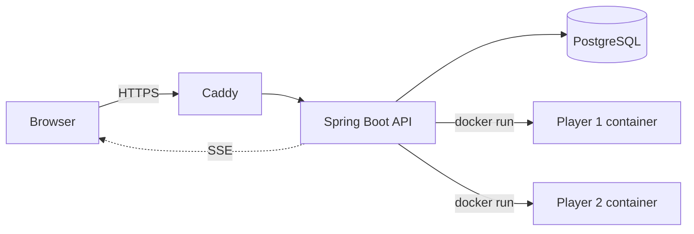

# ctf-backdoor

A small CTF platform where every challenge is a door. You solve it, you get a key, you climb the board.

I built it from scratch (Java + Spring Boot, PostgreSQL, Docker, plain JavaScript) to understand how a real CTF platform works, and to think about how people would try to break it.


## What it does

- Sign up and log in (BCrypt passwords, JWT sessions)
- Challenges with points and difficulty
- **One flag per player.** Flags are generated per user, so sharing an answer does not work
- **Cheat detection.** If you submit someone else's flag, the admin sees who leaked it and who used it
- Challenges that run in **Docker, one isolated container per player**, with the player's own flag inside
- A live scoreboard (Server-Sent Events, no page reload)
- Rate limits on flag attempts and on login

## How it fits together



## Security decisions

| Problem | What I did |
|---|---|
| Players sharing answers | Flag = HMAC-SHA256(secret, userId:challengeId). The user id is inside the flag, so a leaked flag points to who leaked it |
| Guessing flags | Max 5 attempts per minute per player per challenge. The HMAC part is 64 bits |
| Timing attacks on flag checks | Constant-time comparison (`MessageDigest.isEqual`) |
| Database leak | Static flags are stored only as SHA-256 hashes. Passwords use BCrypt |
| Brute-forcing login | 5 failures in 5 minutes, counted by IP + username (not only username, so nobody can lock another person out) |
| Finding valid usernames | Same error message for a wrong user and a wrong password |
| XSS | The front end never uses `innerHTML` with data. Everything goes through `textContent`. Strict CSP, and `connect-src 'self'` so a stolen token cannot be sent elsewhere |
| SQL injection | JPA and named parameters. No string-built queries in the API |
| Abuse of challenge containers | Memory, CPU and process limits, read-only filesystem, all capabilities dropped, `no-new-privileges`, non-root user, a network where containers cannot talk to each other, automatic cleanup after 30 minutes, only images named `ctf-*` are allowed |
| Command injection | `docker` is called with an argument list (never a shell string), and names are validated |
| Becoming admin | There is no API for it. Promotion is done directly in the database |

## Run it locally

```bash
git clone https://github.com/VitoriaChuarts/ctf-backdoor.git && cd ctf-backdoor
cp .env.example .env          # then fill in the secrets, e.g. openssl rand -hex 32
docker compose up -d          # PostgreSQL on port 5433
docker network create -o com.docker.network.bridge.enable_icc=false ctf-challenges
docker build -t ctf-sqli-login:1 challenges/sqli-login
cd backend && set -a && source ../.env && set +a && ./mvnw spring-boot:run
```

Open http://localhost:8081, create an account, then make yourself admin:

```bash
docker exec ctf-db psql -U ctf -d ctf -c "UPDATE users SET role='ADMIN' WHERE username='YOUR_NAME';"
```

Run the tests with `cd backend && ./mvnw test`.

## About the challenges

`challenges/sqli-login` is **vulnerable on purpose** (SQL injection) and it is meant to run only inside the isolated container. Do not deploy it outside this platform.

## What I would improve next

- A separate service that creates containers, so the API does not need access to the Docker socket
- Database migrations (Flyway) instead of `ddl-auto=update`
- Integration tests with a real PostgreSQL
- An admin page in the front end (today challenges are created through the API)
- Keep the token in an `HttpOnly` cookie instead of `localStorage`
